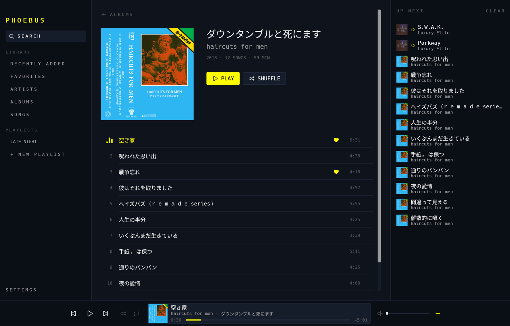
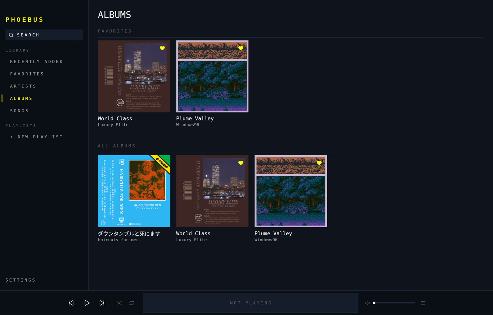
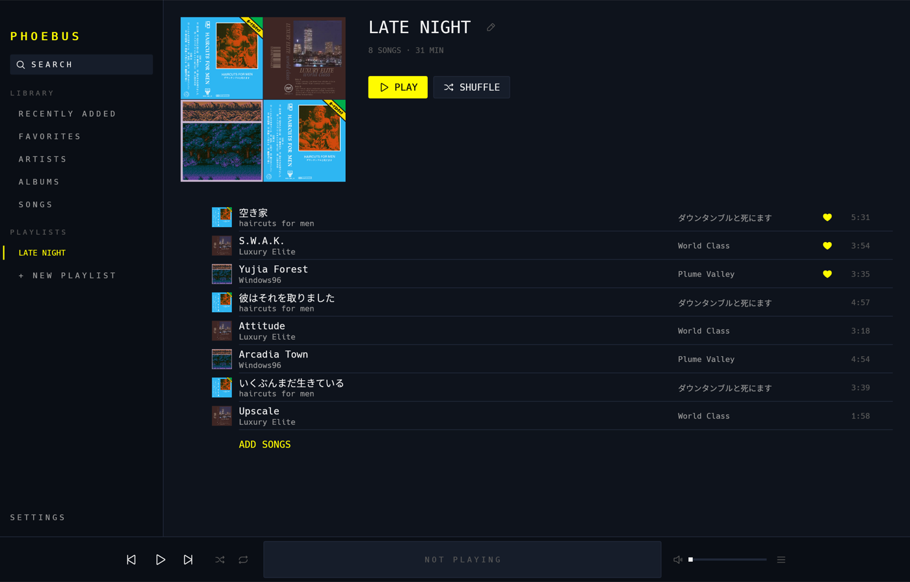
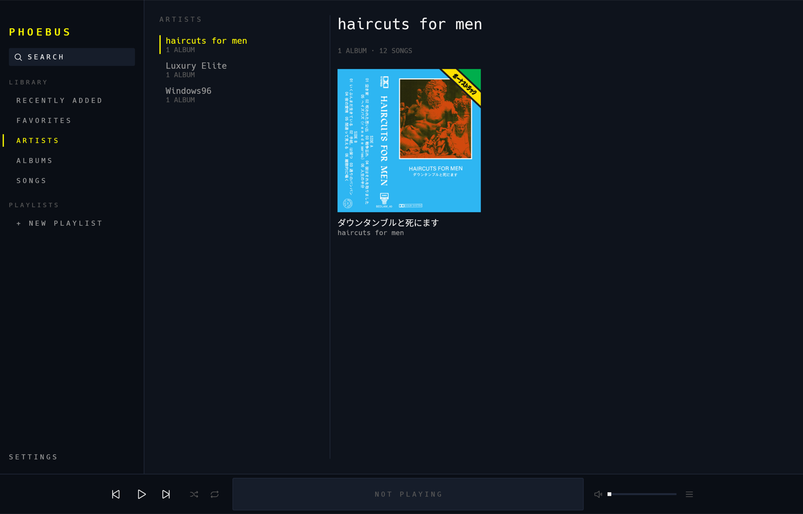
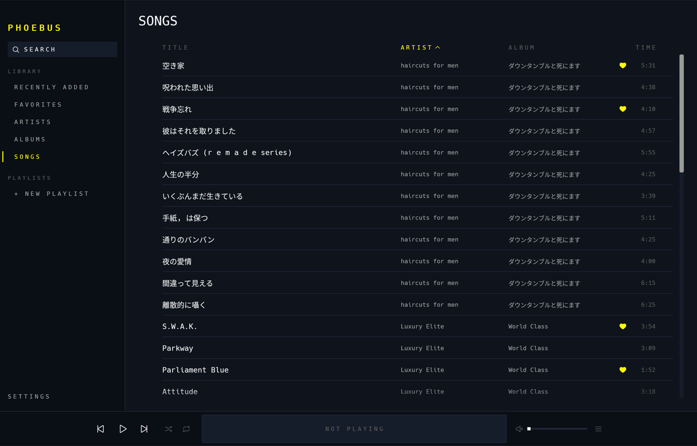

# PHOEBUS ●

A local music player for macOS and Linux that works like Apple Music and looks like a
terminal: pure black, mono type, one neon-yellow accent. Written entirely in Rust.

No streaming, no accounts, no network. Your files, played fast.



|  |  |
|:--:|:--:|
|  |  |

## Install

Grab the latest build from [Releases](https://github.com/ferriskleier/phoebus/releases) —
no toolchain needed.

**macOS** — download `Phoebus-macos-universal.zip`, unzip, move `Phoebus.app` to
`/Applications` if you like, and open it. The app is not notarised, so the first launch
is blocked by Gatekeeper: right-click → **Open** once, or

```
xattr -dr com.apple.quarantine /Applications/Phoebus.app
```

Works on both Apple silicon and Intel (universal binary).

**Linux** — download `phoebus-linux-x86_64.tar.gz`, unpack, run:

```
tar xzf phoebus-linux-x86_64.tar.gz
./phoebus-linux-x86_64/phoebus
```

Needs ALSA (`libasound2`) and D-Bus at runtime — present on any desktop distro. For a
launcher entry and icon, copy `phoebus.desktop` into `~/.local/share/applications/` and
the bundled `icons/hicolor` tree into `~/.local/share/icons/`, with `phoebus` somewhere
on your `PATH`.

## Library

Phoebus reads `~/.phoebus/` by default, laid out exactly like Apple Music's media folder:

```
~/.phoebus/
  Artist Name/
    Album Name/
      01 Track.m4a
      02 Track.m4a
```

Formats: m4a (AAC + ALAC), mp3, flac, ogg, wav, aiff, aac. Tags are read with sensible
fallbacks — an untagged `Artist/Album/01 Title.mp3` still lands in the right place.

Point it anywhere in **Settings** (sidebar, bottom) — including straight at
`~/Music/Music/Media.localized/Music`. Phoebus only *reads* the library root — the one exception
is [importing](#importing), which you start yourself. App data (state, playlists, cover
cache, library snapshot) lives in `~/.phoebus/.phoebus/`, never in your music.

Launch is instant after the first scan: each scan saves the library to `library.json` in the
app-data dir, and the next launch shows it at once while a background scan reads only the
files whose size or modification time changed. **RESCAN** in Settings reads every file again.

Covers come from the art embedded in each song, so every song shows its own — in song lists,
Up Next, the player bar and Now Playing. An album whose songs carry different art, such as a
compilation, gets a four-tile mosaic of its first four covers on its card and page.
`cache/covers/` keeps one PNG per distinct picture, named by a hash of its bytes: twenty
songs with the same art share one file. Each scan writes the missing ones and deletes the
ones no song uses any more. A scan that finds no music (an unmounted drive, for example)
leaves the cache as it is. Art other than PNG or JPEG is not shown.

## Importing

Importing lives in **Settings**, in the IMPORT section between LIBRARY and THEME: a drop
field, and under it the list of everything imported this session. Files can be dropped
anywhere on the window — Settings opens scrolled to IMPORT to show them.

An import behaves like dropping the same files onto Apple Music. Which way it goes depends
on the library root:

- **macOS, root inside the Apple Music media folder** (e.g.
  `~/Music/Music/Media.localized/Music`): Phoebus hands every file to the Music app, which
  copies it into its media folder and files it its own way — the song shows up in Apple
  Music exactly as if it had been dropped there. Edits of fields and covers go through the
  Music app too, so it writes the tags and both libraries agree; only the fields you
  changed are sent. Which folder counts is read from Music's own settings (the media folder
  location under *Files*), so a moved media folder or a symlinked root is recognised and an
  old `iTunes Media` backup is not; only when that setting cannot be read does Phoebus go by
  the folder's name.

  The first import makes macOS ask once: **"Phoebus wants to control Music"** — allow it (or
  later under System Settings › Privacy & Security › Automation). Run from a terminal, the
  prompt names the terminal instead. The Music app does not take FLAC or Ogg; those are
  refused with a reason. If Music does not answer within ten minutes, the row says
  `UNKNOWN — CHECK MUSIC` and that file is not offered to Music again in the session, so a
  second drop cannot add it twice.

  Turn on *Copy files to Music Media folder when adding to Library* in Music's settings.
  With it off, Music keeps pointing at your original file: Phoebus does not see the song,
  and its row cannot be edited here, because an edit would change the original.
- **Linux, or any other root**: Phoebus copies the file to
  `<root>/<Album Artist>/<Album>/<NN Title>.<ext>` — never overwriting an existing file, on
  any file system including FAT and exFAT — and writes edits into the copy's tags.

Either way the dropped original is never modified, and a file that already lives inside
the library root is left alone (`ALREADY IN LIBRARY`). An edit that only partly lands
(say, the fields but not the cover) is shown as `PARTLY SAVED` and keeps what landed. The
list lasts for the session.

## Omarchy

On [Omarchy](https://omarchy.org), Phoebus can wear the active system theme — surfaces,
accent and dark/light mode, switching live with `omarchy-theme-set` — and ship a widget
for the Omarchy bar. One command wires both up:

```
contrib/omarchy/install.sh
```

Media keys and the built-in bar media widget already control Phoebus with nothing
installed (it is a full MPRIS player). See [contrib/omarchy](contrib/omarchy/README.md)
for how the bridge works and how to undo it.

## Build & run

```
cargo build --release
./target/release/phoebus
```

Requires Rust 1.95+. On Linux you'll want ALSA headers (`libasound2-dev`) and the
usual X11/Wayland dev packages for winit.

The binary carries its own icon, so the window, the taskbar and the macOS Dock all show it
straight out of `cargo run`. For a real app instead of a binary:

```
scripts/bundle-macos.sh     -> target/bundle/Phoebus.app, icns and Info.plist included
```

On Linux, copy `assets/icon/hicolor/` into `~/.local/share/icons/` and
`assets/linux/phoebus.desktop` into `~/.local/share/applications/`. The artwork itself
lives in `assets/icon/` as SVG; `scripts/make-icons.sh` regenerates every raster from it
(`assets/README.md` has the details).

## What it does

- **Views**: Recently Added, Artists, Albums, Songs (sortable, virtualized), per-album
  pages, Playlists, live Search (`⌘F`).
- **Player**: play/pause, prev/next, seek, volume, shuffle, repeat (off/all/one),
  Up Next queue with Play Next / Play Later, playback history.
- **Playlists**: create, rename inline, delete, reorder; add songs from any right-click
  menu, or with `+ ADD SONGS` — a picker over the whole library with a live filter.
- **Queue semantics** match Apple Music: playing a song makes its surrounding list the
  context; hand-queued songs always jump the line and survive context switches.
- **Media keys & Now Playing**: hardware play/pause/next/prev, with title, artist and
  the song's cover art in macOS Control Center (MPRIS on Linux).
- **Import** (in Settings): drop songs or whole album folders anywhere on the window, and
  Settings opens at its IMPORT section, which lists each one as it is processed — cover,
  title, artist, album, and `QUEUED` / `IMPORTING` / `IMPORTED` / `ALREADY IN LIBRARY` /
  why it failed — and `✎` on an imported row edits title, artist, album, album artist,
  genre, year, track number and the cover (drop a PNG or JPEG while the editor is open).
  The library rescans by itself when a batch is done — in the background, like the launch
  rescan, reading only new and changed files. See [Importing](#importing).
- **Settings**: pick the library root (`~` expanded, applied with a rescan), import new
  music, and the look — dark or light, six accent presets or any colour you like. Applied
  live, saved on the spot.
- **Resizable panels**: every vertical divider drags — the sidebar, the Up Next drawer and
  the Artists split.
- State (volume, view, shuffle/repeat, window, panel widths, root, theme) persists across
  launches.

Keyboard: `Space` play/pause · `⌘F` search · `⌘←/→` prev/next · `⌘↑/↓` volume · `Esc`
closes the queue drawer / the import editor / leaves search. (`Ctrl` on Linux.)

## Environment

| variable | effect |
|----------|--------|
| `PHOEBUS_LIBRARY` | library root for this run; outranks the Settings value (which is then disabled) |
| `PHOEBUS_DATA` | app-data dir (`state.json`, `playlists.json`, `favorites.json`, `library.json`, `cache/covers/`); default `~/.phoebus/.phoebus` |
| `PHOEBUS_THEME` | `dark` / `light` / `light,#2EF0FF` — palette for one run, never saved |
| `PHOEBUS_START_MUTED` | `1` starts at volume 0 without persisting it |
| `PHOEBUS_SELFTEST_EXPECT` | `"albums,artists,tracks"` minimums for `--selftest` |
| `PHOEBUS_SHOT_ALBUM` | album title the `--shot` tour opens for `album.png` and `playing.png` (default: the first album) |
| `PHOEBUS_SHOT_QUERY` | what the `--shot` tour types for `search.png` (default: `let`) |

## Verification

```
./target/release/phoebus --selftest    # headless: scan, tags, snapshot, decode, seek, persistence
./target/release/phoebus --shot DIR    # screenshot tour of every view into DIR
```

`--selftest` requires at least one album by default. It checks that every distinct cover of
every album is cached, and that the cache holds one file per distinct picture
(`covers.cache`). Its `snapshot.*` lines time the launch path: loading the snapshot and the
incremental rescan, against the full scan. Setting `PHOEBUS_DATA` and
`PHOEBUS_LIBRARY` to temporary directories together keeps a whole verification run off your
real home.

## Workspace

```
crates/phoebus-core    library model, scanner, playlists, queue, search  (no UI deps)
crates/phoebus-audio   playback engine on a dedicated thread (rodio)
crates/phoebus-app     the egui app
```
